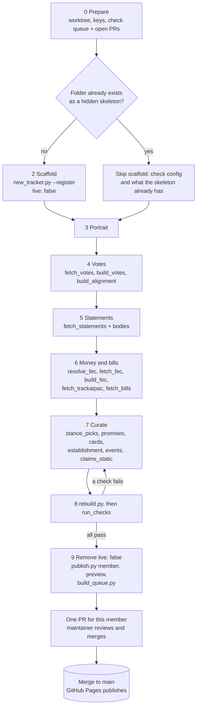
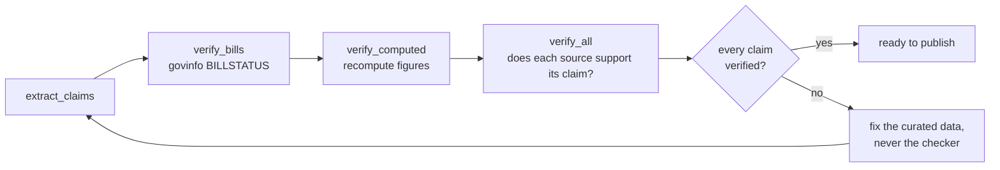
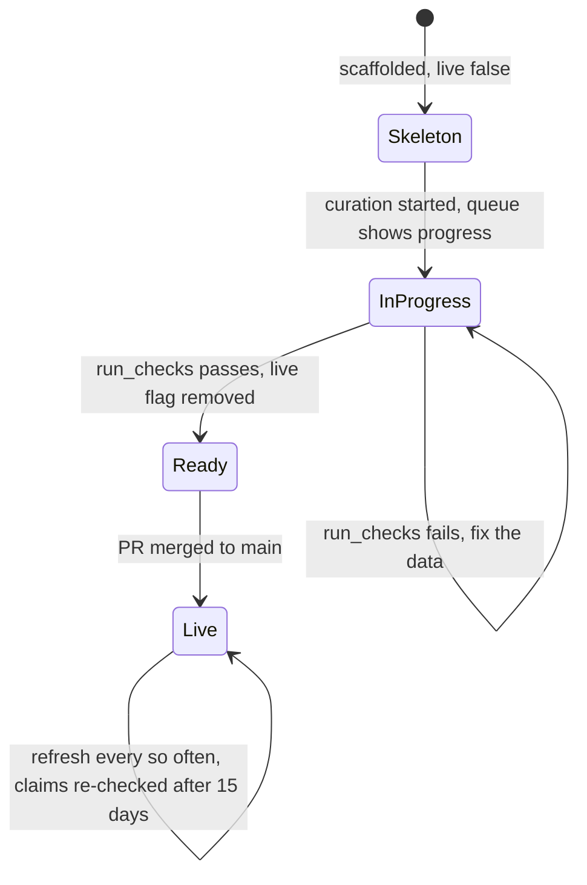

# How to add a member

Time: a few hours of work spread over a day or two, mostly waiting on downloads and curating. If you use Claude Code, the bundled **add-member** skill (`.claude/skills/add-member/`) walks through exactly these steps; just say "add a tracker for Rep. Jane Doe".

Before you start, read [verification.md](../verification.md): the sourcing rules apply to everything you curate.

## The whole flow at a glance



`live: false` is the safety catch. Everything between step 2 and step 9 can be committed, pushed and reviewed without anything appearing on the site.

## Where each step can run

Some sources block automated requests from the cloud, so the work splits between a cloud session (Claude Code on the web, CI) and the maintainer's Mac. Anything that only reads committed files works anywhere.

```mermaid
flowchart LR
    subgraph Cloud["Cloud session or any machine with network and keys"]
        c1[new_tracker.py --register]
        c2[fetch_votes - clerk.house.gov]
        c3[fetch_portrait - bioguide]
        c4[resolve_fec / fetch_fec / build_fec]
        c5[fetch_bills - congress.gov API]
        c6[rebuild.py, status.py, build_queue.py]
    end
    subgraph Mac["Maintainer's Mac (own browser connection, Keychain keys)"]
        m1[fetch_statements + bodies<br/>house.gov and senate.gov press pages]
        m2[fetch_trackaipac]
        m3[Promises: pre-election Wayback snapshot<br/>of the campaign site]
        m4[run_checks: verify_bills, verify_all<br/>fetch live pages]
        m5[Preview, read every page]
    end
    Cloud -- "branch pushed, data committed" --> Mac
    Mac -- "curated files, checks pass" --> PR[Pull request]
```



Known blocks (see [troubleshooting.md](../troubleshooting.md)): senate.gov, most house.gov press pages, Wayback, trackaipac and congress.gov pages answer 403 to cloud requests, so statements, promises sources and `run_checks` are done on the Mac. A 403 means stop, not retry. Roll-call XML needs no download for a new member because it is committed (see step 4).

## 0. Prepare

- Work on a branch, ideally in its own worktree so other work in your checkout is untouched:
  ```bash
  git fetch origin
  git worktree add ../congressreceipts-<last> -b add-<state>-<last> origin/main
  cd ../congressreceipts-<last>
  ```
  On the Mac, run `git checkout <branch>` and `git status` before committing, so the work lands on the right branch.
- Have your FEC and congress.gov API keys set up ([CONTRIBUTING.md](../../CONTRIBUTING.md#api-keys)). Cloud sessions get them as the env vars `FEC_API_KEY` and `CONGRESS_API_KEY`.
- Check `data/queue.json` (or `python3 -I scripts/status.py`) and open pull requests so nobody else is already building this member.
- Only prioritize members who will serve in the next Congress.
- **Pace every fetch**: one request at a time, a few seconds apart, stop at the first 403 or 429 ([CLAUDE.md](../../CLAUDE.md#go-slow-on-other-peoples-websites)).

## 1. Collect the ids

| You need | Where to find it |
|---|---|
| **Bioguide id** (`G000598`) | `data/congress.json` (search the name) or bioguide.congress.gov. A letter and six digits |
| **Senate LIS id** (`S390`), senators only | `<lis_member_id>` in any senate.gov roll-call XML. The Senate XML is committed, so `grep -A8 "Van Hollen (D-MD)" data/rollcalls/senate/119/senate-2025-00001.xml` works in a fresh clone |
| **Pronouns** | The way the member's official biography refers to them. If you cannot confirm, use `they` |
| **Official site and press path** | The member's `.house.gov` / `.senate.gov` site. The press list is usually `/media/press-releases` (House) or `/newsroom/press-releases` (Senate) |

## 2. Scaffold (or pick up a skeleton)

**Check first whether the folder already exists.** The repo holds hidden *skeleton trackers* for many members: a scaffolded folder, official portrait, votes and alignment (and, for some, FEC data), registered with `"live": false` so nothing shows on the site. If `<state>/<last>` exists, do **not** scaffold again (the script refuses a non-empty folder). Open its `tracker.config.json`, fix the `TODO` fields, run `python3 -I scripts/status.py <state>/<last>` to see what is missing, and continue from the first step that has no data yet.

For a new folder:

```bash
python3 -I scripts/new_tracker.py --name "Robert Garcia" --chamber house --state CA --district 42 \
    --bioguide G000598 --pronouns he --site https://robertgarcia.house.gov --out ca/garcia --register

python3 -I scripts/new_tracker.py --name "Chris Van Hollen" --chamber senate --state MD \
    --bioguide V000128 --vote-id S390 --pronouns he --short "Van Hollen" --out md/van-hollen --register
```

Folder = `<state>/<last-name>`, lowercase, hyphenated. The script writes `tracker.config.json` and the `data/` skeletons from `template/` and prints the remaining steps with the right `./tr` commands. It does not run `git init` inside the repo.

Then open `tracker.config.json` and check `member.site`, `pressPath` (both are guesses), `inOfficeSince`, `leader`, `peers`. Set `profile` as you research (committees, facts, offices); every fact typed there also needs a `claims_static.json` entry.

**The member must be in `members.json` with `"live": false` from the start.** `--register` (used above) appends the entry and refreshes `data/queue.json`, where the member shows as `progress`. By hand, use `format: "shared"`, `pages: "stub"`, `chamber`, `voteId`, `portrait: "assets/portrait.jpg"`, `eventsResearched: false`. While `live` is `false`, `publish.py` and the attendance, leaders and directory builds skip the member, so nothing unfinished goes public. Everything below runs through `./tr` and works either way.

## 3. Portrait (always)

```bash
./tr ca/garcia fetch_portrait
```
Open `ca/garcia/assets/portrait.jpg` and confirm it is the current official photo. It uses bioguide first (kept current). If the image is small and a larger official portrait exists, replace it and keep `portraitSource` accurate. Never use an unofficial photo.

## 4. Votes

```bash
./tr ca/garcia fetch_votes                # House: ~690 roll calls per Congress; a few minutes
./tr md/van-hollen fetch_votes_senate     # Senate
./tr ca/garcia build_votes
./tr ca/garcia build_alignment
```
Official roll-call XML is committed once per chamber and Congress in `data/rollcalls/<house|senate>/<congress>/`, and every member reads the same files. `fetch_votes` and `fetch_votes_senate` only add files that are missing, so for an existing Congress a new member needs no download, and if senate.gov answers scripts with HTTP 403 you can skip the Senate fetch (stop at the 403, never retry). Never copy XML into a member folder. Check the roll count against another member of the same chamber (`python3 -I scripts/status.py` shows it); `build_attendance` refuses to build if they differ.

## 5. Statements

```bash
./tr ca/garcia fetch_statements           # add --max-pages 3 for a quick first pass
./tr ca/garcia fetch_statement_bodies
```
Check the first rows against the live press page. If the script reports 0 rows or "Unrecognized layout", the site needs a parser: [add-a-press-layout.md](add-a-press-layout.md). If the site returns 403 to scripts you cannot scrape it: stop, run this step from the maintainer's Mac, or build without statements and say so in the PR. Scripts pause 2 s between press-list pages; keep that, and fetch only the current Congress.

## 6. Money and bills

```bash
./tr ca/garcia resolve_fec        # once; writes the FEC ids into the config
./tr ca/garcia fetch_fec          # slow and rate-limited; re-run to resume
./tr ca/garcia build_fec
./tr ca/garcia fetch_trackaipac
./tr ca/garcia fetch_bills
```
If `resolve_fec` finds several candidates it writes nothing: set `fec.candidateId` and `fec.committeeId` by hand (look the member up on fec.gov). Run **one member's `fetch_fec` at a time**; the API key is limited to about 1,000 calls an hour and a senator needs several thousand calls in total. If the cap is hit, wait the hour; finished files are kept. `fetch_trackaipac` and the campaign-site Wayback lookups are blocked from the cloud, so do them on the Mac.

House members also need the district map: set `geo.countyFips` and `geo.counties`, then `fetch_geo` and `build_map`.

## 7. Curate

This is the editorial work. Each file's format is in [config-reference.md](../config-reference.md); each skeleton in `data/` has a `_note`.

1. **Read first.** List the member's votes (`data/votes.json`) and release titles (`data/statements.json`), then pick issues the member actually works on. Read the official titles of the bills; do not pick by keyword.
2. **`stance_picks.json`**: 6 to 10 issue sections with a mix of roll calls (`roll` + `{Vote}` text) and statements (`u` + an exact quote `q`), plus the Israel/Palestine card.
3. **`promises.json`**: the member's own campaign promises, from a Wayback snapshot of their campaign site. Use `member_bills.json` to find the bills behind each promise. Add every bill you cite to `bills.json`.
4. **`card_picks.json`, `establishment_items.json`, `events.json`, `claims_static.json`** as the skeletons describe.

Quotes must be verbatim. A quick way to guarantee that is to assert it in code before saving: load `statements_full.json`, normalize whitespace, and check `quote in text`.

## 8. Rebuild and check

The offline build stage runs in the right order and skips steps whose inputs did not change; it never touches the network:
```bash
python3 -I scripts/rebuild.py ca/garcia            # build_stances, build_promises, build_establishment, build_cards, build_overview, ...
python3 -I scripts/status.py ca/garcia             # stale builds, roll-call counts, claim results, pages, queue
./tr ca/garcia run_checks                          # run on the Mac: it fetches live pages
```
(`./tr ca/garcia build_stances` and the other `build_*` commands still work one at a time.) `run_checks` runs `extract_claims`, `verify_bills`, `verify_computed` and `verify_all`. Fix the data until every check passes. Never edit a checker to make a claim pass.



**15-day verification cache.** A claim that needs a live page is not re-fetched while its source key is unchanged, it was `verified` and the last check is under 15 days old (`recheckDays` in `data/verify_policy.json`). So a second `run_checks` is quick, and live pages are not hit again and again. Failed, partial or edited claims are always re-checked. Run `verify_all` and `verify_bills` once per change, not in a loop.

## 9. Publish for this member only

1. When `./tr ca/garcia run_checks` passes, **remove `"live": false`** from the member in `members.json` (keep entries append-only to avoid merge conflicts).
2. `python3 -I scripts/publish.py ca/garcia` generates the member's pages (thin stubs that load the shared `site/` through `site/shell.js`, because the member is `pages: "stub"`). Never edit them and never run `publish.py` with no arguments here.
3. Preview: `python3 -m http.server 8000`, open `http://localhost:8000/ca/garcia/`. Read every page.
4. Rebuild the hub if you want the member on it ([rebuild-the-hub.md](rebuild-the-hub.md)).
5. Run `python3 -I scripts/build_queue.py` so `data/queue.json` shows the member as `done` with their URL ([update-the-queue.md](update-the-queue.md)).
6. Commit with explicit paths (`git add <state>/<last> members.json data/queue.json`, never `git add -A`) and open a pull request: **one member per pull request**, no raw data, and no changes to shared files (`site/`, `scripts/`, `hub.*`, `template/`) in the same PR. See [CONTRIBUTING.md](../../CONTRIBUTING.md). Do not merge or deploy: the maintainer does that.



## Special case: a member-elect with no votes yet

A senator- or representative-elect has no roll calls, no bioguide id and no press page on an official site. Scaffold with a placeholder bioguide (`X000000`) and `--vote-id TODO`, build only what exists (money, campaign promises from an archived site, campaign statements), keep `"live": false` on the `members.json` entry and leave the queue alone until they are sworn in. (`--register` marks them `progress` in the queue, so register only when you are ready for that.)
