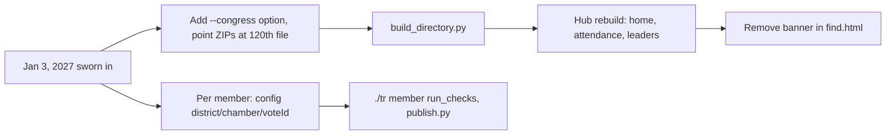

# Switching Find your rep to the 120th Congress (January 2027)

**Short answer:** it is a small, one-day job, not a large rework, but it cannot be done by one flag today. `build_directory.py` is hard-wired to the 119th Congress, and a few things need hand work. Find your rep keeps showing 119th seats, with a banner saying so, until the 120th Congress is sworn in on **January 3, 2027**.

## Why we wait

Members who lost or retired are still the legal representatives until January 3, and several states (for example California, with new maps) change districts. Showing 120th seats now would point a ZIP code at someone who is not yet their representative.

## What changes

| Piece | Today (119th) | At the switch |
|---|---|---|
| `data/directory.json` | House Clerk `MemberData.xml` (seats now) plus senators from the newest Senate roll-call XML | Same sources, rebuilt after the Clerk publishes the new roster and the first 2027 Senate roll call exists. Mostly automatic. |
| `data/zips.json` | Census ZCTA-to-**119th**-district file (`tab20_cd11920_zcta520_natl.txt`, column `GEOID_CD119_20`) | Needs a ZIP-to-120th-district file. We have not confirmed that Census has published a 120th-district ZIP file yet; check before the switch. This is the one input we do not control. |
| ZIP lookup in `find.html` | Reads the two JSON files | No code change. |
| Home cards, attendance, leaders | Built from `members.json` and the directory | Rebuild with the hub scripts after the directory. |
| Tracker headers | `tracker.config.json` `congress`, `district`, `districtLabel` | Per member, when sworn in (Senate switches for Moore, Letlow, Hern, Barr, Hageman and Pappas too: `chamber`, `seat`, `voteId`). |
| Banner in `find.html` | Says 119th | Remove it in the same PR. |

## Is one `--congress 120` rebuild enough?

For the directory and ZIP lookup, nearly. `build_directory.py` now takes `--congress N` (default 119) and `--zcta-url`:

```bash
python3 -I scripts/build_directory.py --congress 120
```

It reads the Census ZIP file `tab20_cd12020_zcta520_natl.txt` (column `GEOID_CD120_20`), the Clerk's `MemberData.xml`, and the newest Senate roll call in `data/rollcalls/senate/120/`. **Checked 2026-11-28: Census has not published this file.** The `rel2020/cd-sld/` folder lists only 118th and 119th ZIP files, and the guessed 120th URL returns 404. Re-check the folder before the switch and pass `--zcta-url` if the file appears under a different name. If it never appears, the fallback is to compute ZIP-to-district from the 120th boundaries that `fetch_geo.py` already pulls from TIGERweb (the layer trackers use for new-district maps); that would be a new script.

## Fallback if Census never publishes a 120th ZIP file

Only needed if the `rel2020/cd-sld/` folder still has no 120th file in late December.

**Constraints found 2026-11-28.** `tigerweb.geo.census.gov` (the boundary service `fetch_geo.py` uses) is blocked in the cloud environment, so this runs on Marilyn's Mac, or after that host is allowed. Scripts are stdlib-only Python, so there is no `shapely` for polygon overlap.

**Plan.**
1. **Reuse every state that did not redistrict.** A state whose district lines are the same in the 119th and 120th keeps its rows in `data/zips.json`. Decide which states changed by comparing each state's 119th and 120th district shapes (TIGERweb layers 4 and 54, the ones the tracker maps already use), or from the official list of new maps; do not guess the list.
2. **Recompute only the changed states.** For each changed state, ask TIGERweb for the ZIP code areas (ZCTAs) that intersect each 120th district, two seconds between requests, one at a time, stopping at the first 403 or 429 (repo rule).
3. **Drop border-touching false positives.** An intersect query also returns ZIP areas that only touch a district edge. Keep a ZIP in a district only when a grid of sample points inside the ZIP area (pure-Python point-in-polygon) falls in that district; ZIPs that split between districts keep every district they touch, as the Census file does today.
4. **Write the result** in the same shape as `data/zips.json` and a note in `data/directory.json` `sources` saying these rows are computed from TIGERweb, not the Census relationship file.
5. **Check** against the 119th: running the same script on the 119th layer for one unchanged state must reproduce the committed `zips.json` rows for it. If it does not, do not publish the computed rows.

**Effort.** About a day to write and verify, then roughly an hour of throttled requests for a few changed states. The Census file, if it appears, replaces all of this with one command.

## What cannot be prepared before January 3

- The Clerk's member list and first 2027 Senate roll call do not exist until the new members are sworn in, so the final directory cannot be built early.
- The six House members who won Senate seats switch chamber, seat and `voteId` only when sworn in.
- Each tracker's `district`, `chamber` and `voteId` changes go in per-member PRs after that.

## Roll-out

Merging to `main` publishes, so the roll-out is the merge of one small PR: directory rebuild, hub rebuild, banner removed. Prepare the branch with the steps above on January 3 (or just before, if the Clerk list is already live), then Marilyn merges.

## Mismatch we already have on purpose

Some trackers show the district a member **won for 2027**, which differs from the 119th seat Find your rep lists:

- **Linda Sánchez**: tracker says CA-41 (2027 map); in the 119th she holds CA-38.
- **Ken Calvert**: tracker says he won the redrawn CA-40; the 119th directory lists him in CA-41.

Both are accurate for their own date. The banner on Find your rep explains the difference; the tracker headers should say "2027 district" wording when edited next.



Order and effort: steps B to E are one small shared-files PR (about half a day, mostly waiting on the ZIP file). Step F is a few minutes per member and goes in one PR per member as usual.
