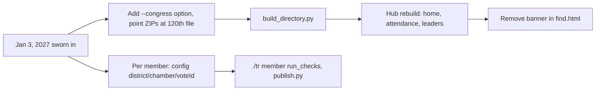

# Switching Find your rep to the 120th Congress (January 2027)

**Short answer:** it is a small, one-day job, not a large rework, but it cannot be done by one flag today. `build_directory.py` is hard-wired to the 119th Congress, and a few things need hand work. Find your rep keeps showing 119th seats, with a banner saying so, until the 120th Congress is sworn in on **January 3, 2027**.

## Why we wait

Members who lost or retired are still the legal representatives until January 3, and several states (for example California, with new maps) change districts. Showing 120th seats now would point a ZIP code at someone who is not yet their representative.

## What changes

| Piece | Today (119th) | At the switch |
|---|---|---|
| `data/directory.json` | House Clerk `MemberData.xml` (seats now) plus senators from the newest Senate roll-call XML | Same sources, rebuilt after the Clerk publishes the new roster and the first 2027 Senate roll call exists. Mostly automatic. |
| `data/zips.json` | Census ZCTA-to-**119th**-district file (`tab20_cd11920_zcta520_natl.txt`, column `GEOID_CD119_20`) | Needs a ZIP-to-120th-district file. We have not confirmed that Census has published a 120th-district ZIP file yet; check before the switch. This is the one input we do not control. |
| ZIP lookup in `find.html` | Reads the two JSON files | No code change. |
| Home cards, attendance, leaders | Built from `members.json` and the directory | Rebuild with the hub scripts after the directory. |
| Tracker headers | `tracker.config.json` `congress`, `district`, `districtLabel` | Per member, when sworn in (Senate switches for Moore, Letlow, Hern, Barr, Hageman and Pappas too: `chamber`, `seat`, `voteId`). |
| Banner in `find.html` | Says 119th | Remove it in the same PR. |

## Is one `--congress 120` rebuild enough?

Not yet. There is no `--congress` option: the Congress number and the Census file name are constants in `scripts/build_directory.py` and `scripts/fetch_geo.py`. The switch PR should (1) add a `--congress` option (default 119), (2) point the ZIP source at the 120th file, (3) rebuild, (4) remove the banner. Then update tracker configs one at a time. Roll-call XML for the 120th goes in `data/rollcalls/<chamber>/120/` as usual.

## Mismatch we already have on purpose

Some trackers show the district a member **won for 2027**, which differs from the 119th seat Find your rep lists:

- **Linda Sánchez**: tracker says CA-41 (2027 map); in the 119th she holds CA-38.
- **Ken Calvert**: tracker says he won the redrawn CA-40; the 119th directory lists him in CA-41.

Both are accurate for their own date. The banner on Find your rep explains the difference; the tracker headers should say "2027 district" wording when edited next.

Order and effort: steps B to E are one small shared-files PR (about half a day, mostly waiting on the ZIP file). Step F is a few minutes per member and goes in one PR per member as usual.
