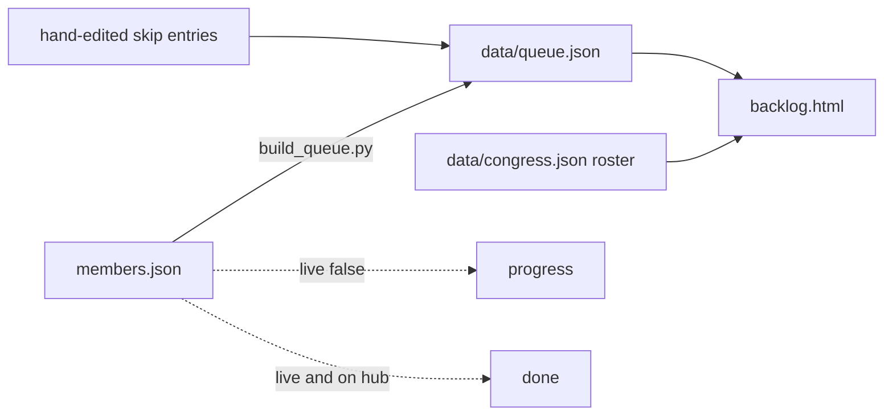

# How to update the Backlog

The Backlog page (`backlog.html`) lists every sitting member of Congress by state and chamber with the status of their tracker. It joins two files:

- `data/congress.json`: the roster, built by `scripts/build_roster.py` from the `unitedstates/congress-legislators` current-members file.
- `data/queue.json`: the status. Entries for tracked members are generated from `members.json` by `scripts/build_queue.py`; only entries for people with no tracker (`skip`) are edited by hand.



## Tracked members: nothing to type

Run `python3 -I scripts/build_queue.py` after you add a member or change `live` / `hub` in `members.json`. A member that is live and on the hub becomes `done` with its URL (`https://congressreceipts.org/<path>/`); anything else in `members.json` (`"live": false` or `"hub": false`) is `progress`. `python3 -I scripts/status.py` (and `build_queue.py --check`) flag a queue that is out of date. Entries for people with no tracker are left alone.

## Change a status by hand (people with no tracker)

Edit `data/queue.json` for `skip` only. Keys are **bioguide ids**.

```json
{
 "R000620": {"status": "done", "url": "https://congressreceipts.org/ca/rivas/"},
 "G000598": {"status": "progress"}
}
```

| `status` | Shown as |
|---|---|
| `done` | Live (links to `url`) |
| `progress` | In progress |
| `skip` | Skipped |
| *(not listed)* | Not started |

Rules
- Registering a member in `members.json` (even with `"live": false`) marks them `progress` once you run `build_queue.py`, so two people do not build the same member. They become `done` when the flags come off.
- Keep the file's one-line-per-member layout so diffs stay small.
- Do this in **its own small pull request** (queue changes only). That keeps it fast to merge and out of the way of data work.
- A member-elect has no bioguide id and is not on the roster, so cannot be listed until sworn in.

## Refresh the roster

Needed after resignations, special elections or the start of a new Congress:
```bash
curl -sL https://unitedstates.github.io/congress-legislators/legislators-current.json -o /tmp/legislators-current.json
python3 -I scripts/build_roster.py /tmp/legislators-current.json data/congress.json /tmp/congress.md
```
The third argument is a Markdown summary the page does not use; write it outside the repo. Review the diff of `data/congress.json`, then commit it.
